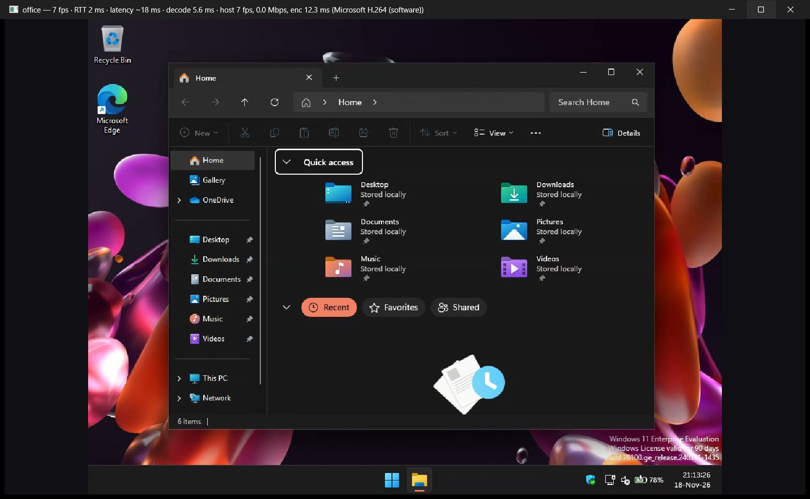
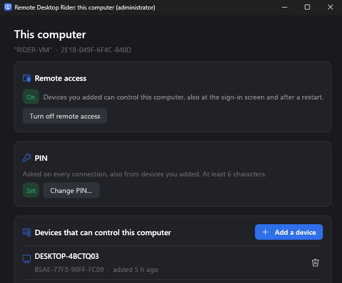
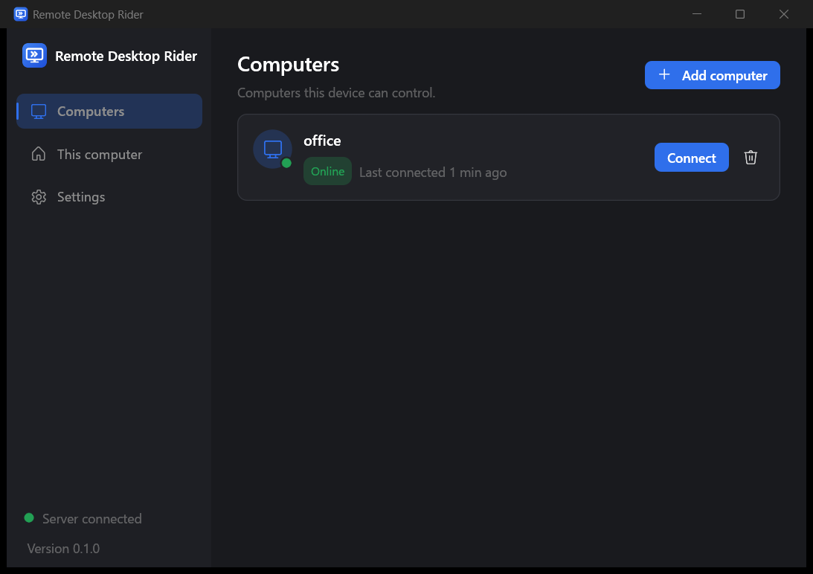
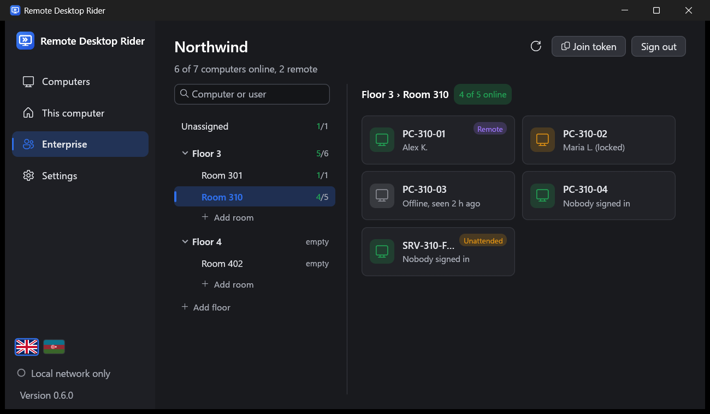
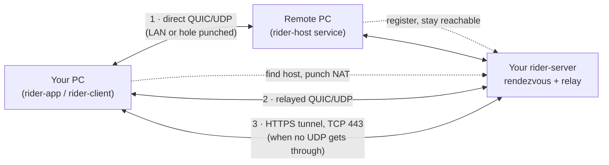

<h1 align="center">Remote Desktop Rider</h1>

<p align="center">
  <b>Fast, private 1:1 remote desktop for Windows that stays usable on bad connections.</b><br>
  Help a family member, reach your office PC from home, or support a customer:<br>
  over mobile data, hotel Wi-Fi, a strict company firewall or a slow VPN.
</p>

<p align="center">
  <a href="https://github.com/codewithelvin/remote-desktop-rider/releases/latest"></a>
  <a href="https://github.com/codewithelvin/remote-desktop-rider/actions/workflows/ci.yml"></a>
  
  
  
  <a href="LICENSE"></a>
  <a href="https://github.com/codewithelvin/remote-desktop-rider/releases"></a>
</p>

<p align="center">
  <a href="https://codewithelvin.github.io/remote-desktop-rider/"><b>Website</b></a> ·
  <a href="https://github.com/codewithelvin/remote-desktop-rider/releases/latest"><b>Download</b></a> ·
  <a href="#quick-start"><b>Quick start</b></a> ·
  <a href="#security"><b>Security</b></a> ·
  <a href="#self-hosting-the-server"><b>Self-hosting</b></a> ·
  <a href="docs/ENTERPRISE.md"><b>Enterprise</b></a> ·
  <a href="#troubleshooting"><b>Troubleshooting</b></a> ·
  <a href="#code-signing"><b>Code signing</b></a>
</p>

<p align="center">
  
</p>

## Features

| | |
|---|---|
| **Smooth on poor networks** | QUIC over UDP, hardware H.264 (QuickSync / NVENC / AMF), a locally drawn cursor, stale frames dropped instead of resent, and live adaptive bitrate (300 kbps–20 Mbps). |
| **Quality you can pick** | **Auto / 1080p / 720p / 480p** in the session toolbar. *Auto* lowers the resolution on slow connections and raises it again when the link recovers. |
| **Private by design** | Devices pair once by comparing a code. Every session is end-to-end encrypted and needs the computer's PIN. No accounts, no cloud. |
| **Gets through firewalls** | Direct on the LAN, NAT hole punching or an encrypted relay across the internet. Falls back to a random UDP port, then to an HTTPS (TCP 443) tunnel through the system proxy. |
| **Works everywhere on the host** | Login screen, lock screen, UAC prompts and after a restart. |
| **Everyday tools** | Chat with files both ways (one-time sessions keep nothing afterwards), text clipboard sync, drag-and-drop files, multi-monitor switching, Ctrl+Alt+Del, lock the remote PC. |
| **Self-hosted** | The optional `rider-server` runs on any small Linux machine. It introduces devices and relays encrypted traffic; it can't watch or take over sessions. |
| **Keeps itself current** | Hourly update checks, SHA-256 verified installers, unattended updates for PCs you only reach remotely. |
| **Quick connect** | One-time help by a short code: no pairing, no PIN, the person at the computer clicks **Allow** with an access level (Full access, Standard or View only) they can change at any time. The code works once and expires after 10 minutes. |
| **Enterprise mode** | One admin looks after a company's computers by floor and room; each employee accepts or declines the admin's request. Rolled out by Group Policy with the company installer. See [the guide for IT](docs/ENTERPRISE.md). |
| **English and Azerbaijani** | The whole interface in either language, switched with a click on the flag. |
| **Windows, macOS and Linux** | Control computers from Windows, a Mac (Apple Silicon and Intel) or Debian/Ubuntu. Being controlled is Windows-only for now. |
| **Small and native** | One ~8 MB installer. Rust end to end. |

## Quick start

### 1. Install

From the [latest release](https://github.com/codewithelvin/remote-desktop-rider/releases/latest)
(or the [website](https://codewithelvin.github.io/remote-desktop-rider/#download)):

| System | File | Can |
|---|---|---|
| Windows 10/11, 64-bit | `rdr-setup-x.y.z.exe`: run it | control and be controlled |
| macOS 11+, Apple Silicon and Intel | `RemoteDesktopRider-x.y.z-macos.dmg`: drag the app to Applications | control |
| Debian 12+ / Ubuntu 22.04+, x86_64 | `remote-desktop-rider_x.y.z_amd64.deb`: `sudo apt install ./remote-desktop-rider_x.y.z_amd64.deb` | control |

The computer you want to control needs Windows. Every push to `main` is built
and published automatically; `SHA256SUMS` in each release covers every file.

> [!WARNING]
> Nothing is code-signed: the certificates that show a publisher name cost
> money every year, and this open-source project has no budget for one
> ([why, and how to check a download](#code-signing)). So for a while the
> publisher shows as **Unknown** and your system may warn that the app is
> unsafe to install. **Windows:** click **More info → Run anyway**.
> **macOS:** open **System Settings → Privacy & Security** and click **Open
> Anyway** (or right-click the app → **Open**).

### 2. Pair (once per device)

<table>
  <tr>
    <td width="50%"></td>
    <td width="50%"></td>
  </tr>
  <tr>
    <td><b>On the computer to control</b>: open <i>This computer → Manage this
    computer</i>, set a PIN, turn on remote access and click <b>Add a device</b>.
    It shows a short code.</td>
    <td><b>On your device</b>: click <b>Add computer</b>, enter that code and
    check that both screens show the same verification code.</td>
  </tr>
</table>

To pair and connect across networks, set your `rider-server` address and
fingerprint once per computer in **This computer → Manage → Server** (see
[Self-hosting](#self-hosting-the-server)). It applies in both directions: being
reached and reaching others. On macOS and Linux it is in **Settings → Server**.
Without a server, devices on the same network can
still pair by address.

### 3. Connect


Click **Connect** and enter the PIN. Tick **Remember PIN on this device** and
later connections open straight away, like unattended access in other tools
(the PIN is encrypted for your Windows account).

The remote computer shows a red banner while someone is connected. Clicking it
ends the session.

The app lives in the notification area, starts when you sign in (you can turn
this off in Settings) and shows which of your computers are online. **Connect**
stays disabled while a computer is offline and turns on when it comes back.

<br clear="right">

### Quick connect: one-time help with a code

For helping someone once, without pairing devices or sharing a PIN:

1. **The person who needs help** opens Remote Desktop Rider, goes to
   **This computer** and clicks **Get a one-time code**. No administrator
   rights are needed. A code such as `SF6-CK6` appears.
2. **The helper** clicks **Quick connect** on the Computers page and enters
   that code.
3. The person sees who wants to connect and a verification code (the helper
   sees the same one), chooses what the helper may do and clicks **Allow**:

   | Access level | See the screen | Mouse and keyboard | Clipboard | Send files |
   |---|---|---|---|---|
   | **Full access** | yes | yes | yes | yes |
   | **Standard** | yes | yes | yes | no |
   | **View only** | yes | no | no | no |

   The level can be changed at any time while the session runs. The
   computer being helped enforces it, and the helper's toolbar and window
   title show it (for example **View only**).
4. While the session runs, the two of you can **chat and send files** both
   ways: the helper with the **Chat** button on the session toolbar (the
   panel opens beside the remote screen), the person being helped in the
   app's window, which shows the session with the chat. Messages stay in
   memory only; received files sit in a private temporary folder until the
   session ends and are then deleted, unless someone chose **Save as…**.
   Files need **Full access**.

The code works **once** and expires after **10 minutes**. Nothing is kept
afterwards: the computer uses a throwaway key and is not added anywhere. Either
side can end the session (the red bar or **End session** on the computer being
helped, **Disconnect** for the helper). Both computers need the server set
(see [Self-hosting](#self-hosting-the-server)). In a quick session, windows
running as administrator and UAC prompts can't be controlled; use regular
paired access for those.

### Language

The interface is available in **English** and **Azerbaijani**. Switch with the
flag buttons in the sidebar or in **Settings**. The session window and the
Manage window follow the same choice, and so does the red session banner.

## In a session

Click the small tab at the top centre of the session window to open the toolbar:

| Toolbar item | What it does |
|---|---|
| Session timer | How long you have been connected |
| **Full screen** | Toggle full screen |
| **Ctrl+Alt+Del** | Send Ctrl+Alt+Del to the remote computer |
| **1 DELL U2720Q, 2 …** | Switch between remote monitors, by their own names (shown when there are several; the one on screen is also named in the top-left corner) |
| **Tunnels** | Reach a port on the remote computer or its local network (shown only when that computer allows tunnels; Full access only; see below) |
| **Quality ▾** | Auto / 1080p / 720p / 480p |
| Pin | Keep the toolbar open instead of hiding it |
| **Disconnect** | End the session (click it twice: the first click asks "Click again to disconnect") |

While the session window is in front, Windows key combinations (Win+R, Win+E,
Win+P…), Alt+Tab, Alt+Esc, Ctrl+Esc and Alt+F4 act on the remote computer.

| Shortcut | Action |
|---|---|
| `Ctrl+Alt+End` | Ctrl+Alt+Del on the remote computer (login / lock screen) |
| `Ctrl+Alt+Shift+L` | Lock the remote computer |
| `Ctrl+Alt+Shift+F` | Toggle full screen |
| `Alt+1` … `Alt+9` | Show that remote monitor |
| `Ctrl+Alt+Shift+M` | Next monitor |
| `Ctrl+Alt+Shift+Q` | Disconnect |
| `Ctrl+Alt+Shift+C` | Open or close the chat |
| Drag a file onto the window | Send it into the chat (paired sessions: it is kept in the remote user's `Downloads\Rider`) |

The text clipboard syncs both ways. The title bar shows fps, round-trip time,
estimated latency and the encoder in use.

### TCP tunnels

Reach a web admin page, a NAS or any other TCP port on the remote computer or
its local network, as if it were on your own computer. In the toolbar, open
**Tunnels**, type the address there (for example `192.168.1.20:443`) and open
the local address it gives you (for example `127.0.0.1:51234`). From the
command line: `rider-client connect office --forward 8443:192.168.1.20:443`.

- **Off until that computer's administrator turns them on**, in the app
  (This computer > TCP tunnels into this network) or with
  `rider-host tunnels ask|allow|off`. While off, the Tunnels button is hidden.
  One-time support sessions never offer tunnels.
- Only in **Full access** sessions.
- With **ask**, the person at that computer approves each new address once per
  session (the request is declined by itself after 60 seconds); **allow** skips
  the question, for unattended computers.
- Only that computer and private addresses on its network can be reached,
  never the internet. Your end listens on `127.0.0.1` only.

## Enterprise mode

For companies: one IT admin looks after every Windows PC from the app, on
your own `rider-server`.

<p align="center">
  
</p>

- **Rolled out by Group Policy.** A startup script installs Rider on every
  domain PC and joins it with a token. New PCs wait under *Unassigned*; drag
  them to their floor and room (many at once with Ctrl or Shift).
- **The employee decides.** Each connection asks the person at the PC to
  *Accept* or *Decline*. No answer within a minute, a locked screen or nobody
  signed in: no session.
- **Unattended only when both agree:** the installer's `/UNATTENDED` switch
  *and* the admin's switch for that PC.
- **One admin, pinned.** Company PCs trust only the admin's device key; other
  devices can't list or reach them. Tested with 5,000 computers.
- **Office or remote at a glance.** A laptop working from home over the
  company VPN (e.g. GlobalProtect) is marked *Remote*; each PC tells by
  whether its Windows domain is on its own network or only through the VPN.

Setting it up: [the guide for IT](docs/ENTERPRISE.md).

## How it connects



1. **Direct.** On the same network, or across the internet once the server has
   helped both sides punch through their NATs. LAN addresses are tried first.
2. **Relay.** When no direct path works, the session goes through the server's
   UDP relay.
3. **HTTPS tunnel.** Where no UDP gets through at all (some company networks),
   both sides carry their traffic inside a WebSocket over HTTPS on port 443,
   through the system proxy, like a browser. Sessions then use the relay.

On every path the session is end-to-end encrypted with the keys pinned at
pairing. The server and relay only see ciphertext. If the host's usual UDP
port 47800 is filtered, it also uses a second, random high port for the server
and for sessions through it. If the server is down, a known direct address is
still tried. The viewer shows which path it chose.

## Security

- **Device keys, pinned at pairing.** Every device has its own **Ed25519
  identity key**. There is no CA and no central server that could be
  compromised to impersonate a host.
- **Pairing by code, confirmed on both sides.** The host opens a pairing window
  and shows a short code. Both screens then show a 6-digit **verification code**
  derived from both keys *and* the live TLS session. The two people compare
  them; a man-in-the-middle would produce different codes.
- **Mutual TLS.** After pairing, both sides pin each other's key. The host
  rejects unpaired devices **during the TLS handshake**, before any application
  code runs. The client refuses a host whose key changed.
- **A PIN for every session.** Argon2id-hashed, exponential back-off, locked
  for 15 minutes after 10 failures. A stolen client laptop is not enough on its
  own.
- **One session at a time**, with a red banner on the host while someone is
  connected. The banner is hidden from the stream; clicking it ends the session.
- **The server sees only ciphertext.** It can't watch, take over or
  impersonate a host. It answers the same "offline or not allowed" to everyone
  not paired with a host and rate-limits requests per IP (for the HTTPS tunnel,
  per real client address).
- **Locked-down files.** The host's private key and trust store live in
  `%ProgramData%\RemoteDesktopRider`, readable only by SYSTEM and Administrators.

### Connection diagnostics

To help tune connections, both ends of a session send **your own server** a
small report when it ends (and every 10 minutes during long ones). Every 5
seconds it samples round-trip time, packet loss, frame rate, bitrate, encode or
decode time and latency, plus whether the path was direct, relayed or tunneled.

Reports hold **numbers only**: no screen content, input, names or addresses.
The server accepts them only from devices it knows and writes them to its log
(`journalctl -u rider-server | grep diag`). Host and client reports of one
session share a random session number.

## Updates

The app and the host service check GitHub Releases every hour.

- **App:** shows a tray notification and an **Update to x.y.z** item in the tray
  menu. One Windows permission prompt, then it reopens by itself.
- **Service:** on a computer with remote access turned on, installs a new
  release unattended when nobody is connected and is back online within a
  minute, so a PC you only reach remotely stays current.
- Every download is checked against the **SHA-256** published with the release.
- Both can be turned off (Settings → Updates; Manage → Remote access, or
  `rider-host auto-update off`). IT can deploy silently with
  `rdr-setup-x.y.z.exe /VERYSILENT /SUPPRESSMSGBOXES /NORESTART`.

## Self-hosting the server

Without a server, devices reach each other only on the same network, over a
VPN or through a port forward. To connect from anywhere, run the small
`rider-server` on any machine both sides can reach (a cheap VPS is plenty). A
Linux x86_64 binary is attached to every release.

**Install or upgrade with one command** (Linux x86_64 with systemd):

```sh
curl -fsSL https://codewithelvin.github.io/remote-desktop-rider/install.sh | sudo bash -s -- <public-ip>
```

It downloads the latest `rider-server` release, checks its SHA-256, installs
the hardened systemd unit, opens UDP 47900 and 47901–47999 in ufw and prints
the **address and fingerprint** to enter on your computers. Run it again to
upgrade: the server key is kept, so the fingerprint never changes.

- `<public-ip>` is optional. Without it the script detects the address, but
  pass it behind cloud NAT (AWS, GCP, …) to be sure. Note the `-s --`:
  `bash <ip>` alone would treat the address as a script name.
- **For networks that block UDP**, add the HTTPS fallback in the same step:
  `… | sudo bash -s -- <public-ip> --domain rider.example.com --email you@example.com`.
  This installs nginx and a Let's Encrypt certificate for that name (its DNS must
  already point at the server; open TCP 80 and 443).
- `--version 0.1.8` installs a specific release.
- The script is [`deploy/get.sh`](deploy/get.sh) (also at
  `https://raw.githubusercontent.com/codewithelvin/remote-desktop-rider/main/deploy/get.sh`).
  Read it first if you prefer.

<details>
<summary>Manual install</summary>

1. Download `rider-server-<version>-linux-x86_64` from the
   [latest release](https://github.com/codewithelvin/remote-desktop-rider/releases/latest)
   and save it as `rider-server` next to [`deploy/install.sh`](deploy/install.sh)
   and [`deploy/rider-server.service`](deploy/rider-server.service).
2. Run `sudo bash install.sh [public-ip]`.
3. Print the fingerprint with `sudo rider-server --state-dir /var/lib/rider-server info`.
4. Optional: nginx in front for the HTTPS tunnel, as described in
   [`deploy/nginx-rider-tunnel.conf`](deploy/nginx-rider-tunnel.conf), and open
   TCP 443.

</details>

**Then, once per computer:** enter the server name (e.g. `rider.example.com`)
and fingerprint in **This computer → Manage → Server**, or use the command line:

```powershell
rider-host   set-server rider.example.com <server-fingerprint>   # host; restart the service after
rider-client set-server rider.example.com <server-fingerprint>
```

## Command line

The app runs these tools for you; they also work on their own.

<details>
<summary><b>Host</b> (<code>rider-host</code>, the machine to be controlled)</summary>

All host commands except `support` need an **elevated** terminal (Run as administrator).

```powershell
rider-host set-pin             # once
rider-host service install     # unattended access: login screen, UAC, after reboot
rider-host pair                # once per new client device (pauses the service meanwhile)
```

`service install` copies the binary to `%ProgramFiles%\RemoteDesktopRider`, so
only administrators can replace what runs as SYSTEM. It also adds a firewall
rule for UDP 47800, registers auto-restart on failure, and allows Ctrl+Alt+Del
from services.

| Command | Purpose |
|---|---|
| `service status\|start\|stop\|uninstall` | Manage the service (uninstall keeps pairings) |
| `set-pin` | Set or change the session PIN |
| `clients` / `revoke <device>` | List or remove paired devices |
| `info` | Show this host's identity and settings |
| `set-server <addr> <fingerprint>` | Use a rendezvous server |
| `auto-update on\|off` | Unattended updates (on by default) |
| `tunnels ask\|allow\|off` | TCP tunnels into this computer's network: ask the person here for each address, allow without asking (Full access only), or off (default) |
| `run [--pair]` | Serve from the terminal until Ctrl+C, without the service |
| `language en\|az` | Language of the red session banner the service shows (Manage keeps it in step with the app) |
| `support <server> <fingerprint>` | One-time support session (quick connect): shows a code and asks before letting anyone in. **No administrator rights needed**; uses a throwaway key and none of the settings above |

`set-pin`, `revoke` and `clients` apply to the running service immediately.
Logs: `%ProgramData%\RemoteDesktopRider\host\logs`.

</details>

<details>
<summary><b>Client</b> (<code>rider-client</code>)</summary>

```powershell
rider-client pair 192.168.1.20 --name office   # same network: compare the code with the host
rider-client pair SF6-CK6                       # any network, with a server set
rider-client connect office                     # asks for the PIN
rider-client quick SF6-CK6                      # one-time session; the person there clicks Allow
```

| Command | Purpose |
|---|---|
| `pair <code or address>` | One-time pairing with a host running `rider-host pair` |
| `connect <name or address>` | Open a session |
| `quick <code>` | Quick connect: a one-time session by the code the other computer shows (no pairing or PIN; the person there allows it) |
| `--forward [LOCAL_PORT:]HOST:PORT` | With `connect`, `quick` or `company-connect`: open a TCP tunnel, repeatable (see [TCP tunnels](#tcp-tunnels)) |
| `list` / `forget <host>` | List or remove paired hosts |
| `info` | Show this device's identity |
| `set-server <addr> <fingerprint>` | Use a rendezvous server |

With a server set, `rider-host pair` also shows a short code (e.g. `SF6-CK6`).
`connect` asks the server for the host's addresses, punches through both NATs
and uses a direct path when one works (LAN first), or the relay when it
doesn't.

</details>

<details>
<summary><b>Server</b> (<code>rider-server</code>)</summary>

```sh
rider-server run                 # UDP 47900 + relay ports 47901-47999
rider-server info                # prints the fingerprint and setup commands
```

`run` also takes `--public-ip` (behind NAT), `--relay-ports` and
`--tunnel-listen 127.0.0.1:47900` (the HTTPS tunnel behind a TLS web server).
See [`deploy/rider-server.service`](deploy/rider-server.service) for the full
command line used in production.

</details>

## Troubleshooting

<details>
<summary><b>Win+L locks my own PC, not the remote one</b></summary>

Windows reserves Win+L (and Ctrl+Alt+Del) for the local computer. Use
`Ctrl+Alt+Shift+L` to lock the remote computer, and `Ctrl+Alt+End` or the
toolbar for Ctrl+Alt+Del.

</details>

<details>
<summary><b>No code appears when I click "Add a device"</b></summary>

The code comes from your server. Set the **Server** in **This computer →
Manage** (address and fingerprint), then try again. Without a server, only
devices on the same network can add this computer, using one of the addresses
the dialog shows.

</details>

<details>
<summary><b>It doesn't connect from a company network</b></summary>

This is handled automatically when the server is set up for it. If UDP 47800
is filtered, the host uses a random high port. If no UDP gets through at all,
both sides switch to the HTTPS tunnel on TCP 443 through the system proxy. That
needs nginx with a real certificate on the server: see
[`deploy/nginx-rider-tunnel.conf`](deploy/nginx-rider-tunnel.conf).

</details>

<details>
<summary><b>The picture is blurry or choppy</b></summary>

On *Auto*, quality follows the connection. Pick a fixed resolution in the
toolbar's quality menu if you prefer: 720p or 480p often feels smoother on a
weak link. The title bar shows round-trip time and latency to tell you how the
connection is doing.

</details>

<details>
<summary><b>SmartScreen warns about the installer</b></summary>

The installer isn't code-signed yet. Click **More info → Run anyway**. Updates
are checked against the SHA-256 published with each release.

</details>

## Under the hood

<details>
<summary><b>Why it stays fast</b></summary>

| Problem on bad links | What Rider does |
|---|---|
| TCP head-of-line blocking (one lost packet freezes everything) | **QUIC over UDP**. Each video frame travels on its own stream, and mouse motion goes as unreliable datagrams. |
| Retransmitting stale pixels | Frames that are not delivered within 500 ms are **abandoned**. The client asks for a fresh keyframe instead of waiting. |
| Queues building up (bufferbloat) | **At most 3 frames in flight**. If the network is busy, capture is skipped, so the next frame is always *now*. |
| Random loss collapsing throughput | **BBR** congestion control plus a delay-based **adaptive bitrate** (300 kbps–20 Mbps, changed live without keyframes). |
| Too many pixels for the bitrate | **Auto quality** drops to 720p or 480p when the bitrate stays low, and steps back up after a long good stretch. |
| Encoder/decoder buffering | H.264 in **low-latency mode**: no B-frames, CBR, hardware encoder (QuickSync / NVENC / AMF) with software fallback. |
| Laggy pointer | The **cursor is drawn locally** on the client, so it never waits for the network. |
| Wasted bandwidth on static screens | **Zero traffic** when nothing changes, then a few refinement frames sharpen the image. |

</details>

<details>
<summary><b>How unattended access works</b></summary>

A service running in session 0 can't see the screen. The `RemoteDesktopRider`
service (LocalSystem) therefore launches `rider-host agent` **as SYSTEM inside
the active console session** and relaunches it whenever that session changes
(logon, logoff, user switch) or the agent exits. The agent runs in a
kill-on-close job object, so it never outlives the service. Its capture and
input threads follow the *input desktop*, which is how they reach the login
screen, lock screen and UAC prompts. Ctrl+Alt+Del is generated with `SendSAS`.

</details>

## Building from source

Needs Rust stable, the MSVC build tools and the Windows 10/11 SDK (`rc.exe`, for
the app icon).

```powershell
cargo build --release              # optimised, as released
cargo build --profile quick        # day-to-day: no LTO, ~30 s rebuilds (target\quick)
.\packaging\windows\build.ps1      # installer (needs Inno Setup 6) -> target\installer
```

macOS and Linux build the app and the session viewer (not the host):

```sh
cargo build --release -p rider-app -p rider-client
packaging/macos/build.sh 0.3.0       # universal .app and .dmg (on a Mac)
packaging/linux/build-deb.sh 0.3.0   # .deb (on Debian/Ubuntu)
```

<details>
<summary><b>Releases</b></summary>

GitHub Actions ([`ci.yml`](.github/workflows/ci.yml)) builds every push. Each
push to `main` that passes fmt, clippy and the tests gets the next patch version
(`v0.1.0`, `v0.1.1`, …) and is published with `rdr-setup-<version>.exe` and
`rider-server-<version>-linux-x86_64`; the macOS `.dmg` and the Debian/Ubuntu
`.deb` are added by their own jobs a few minutes later. Bump `major.minor` in `Cargo.toml` for
bigger steps.

</details>

## Project layout

```
crates/
  rider-app     the desktop app (computer list, pairing, this computer's settings, tray)
  rider-client  viewer window, network session, in-order decoder thread, CLI
  rider-host    capture (DXGI, GDI fallback), video pipeline, input injection, banner,
                sessions, Windows service + SYSTEM session agent
  rider-core    identity, pinned TLS, pairing code, protocol, rendezvous, HTTPS tunnel,
                diagnostics, clipboard, pixel conversion
  rider-media   Media Foundation H.264 encoder (hardware first) and decoder
  rider-server  rendezvous (registration, pairing codes, NAT hole punching), UDP relay,
                HTTPS tunnel endpoint, diagnostics log
packaging/      Windows installer (Inno Setup)
deploy/         systemd unit, install script and nginx config for rider-server
test/           Vagrant VMs: Windows 11 host (vm/), Ubuntu rider-server (server-vm/)
```

## Roadmap

See [docs/ROADMAP.md](docs/ROADMAP.md). Next up: all monitors in one window,
code signing, then performance on poor links (GPU conversion and decoding, FEC,
intra-refresh) and host→client files, audio and an audit log. Macs and Linux PCs
can control others today; letting them be controlled is next
([docs/MACOS.md](docs/MACOS.md)).

## Code signing

> [!WARNING]
> **Why your system may warn you.** Showing a verified publisher name needs a
> code signing certificate, and those cost money every year. Remote Desktop
> Rider is made by open-source enthusiasts with no budget for one, so for a
> while Windows will show the publisher as **Unknown**, and Windows or macOS
> may warn that the app could be unsafe to install.

What you can rely on instead:

- **Open source:** every line of the app is in this repository.
- **Built in public:** every release is built from this source by the GitHub
  Actions workflow ([`ci.yml`](.github/workflows/ci.yml)); nothing is built on
  a personal computer.
- **Checksums:** each release lists the SHA-256 of every file in
  `SHA256SUMS`. Compare it with your download (PowerShell:
  `Get-FileHash rdr-setup-x.y.z.exe`; macOS/Linux: `shasum -a 256 <file>`).
- **Updates** downloaded by the app are checked against the same SHA-256
  before they run.

To get past the warning: on Windows click **More info → Run anyway**; on macOS
open **System Settings → Privacy & Security** and click **Open Anyway**.

## Privacy

Remote Desktop Rider has no accounts and collects nothing for its authors.
It only connects to:

- **The other computer** in a session, end-to-end encrypted.
- **The rendezvous server you set** (`rider-server`, normally your own), to
  pair, show which computers are online, relay traffic when no direct path
  exists, and receive a connection-quality report per session (route, frame
  rate, latency, bandwidth, version; no screen content, keystrokes or files).
  Without a server set, it talks to nothing but the other computer.
- **GitHub** (Windows app), to check for and download updates from this
  repository's releases. Automatic checks can be turned off in Settings.

The website's download buttons ask GitHub's public API for the latest release
files; see [GitHub's privacy statement](https://docs.github.com/site-policy/privacy-policies/github-general-privacy-statement).

## Contributing

Bug reports, ideas and pull requests are welcome.

- **Questions and ideas:** [Discussions](https://github.com/codewithelvin/remote-desktop-rider/discussions).
- **Bugs and feature requests:** [Issues](https://github.com/codewithelvin/remote-desktop-rider/issues/new/choose).
- **Code:** [CONTRIBUTING.md](CONTRIBUTING.md) explains how to build, test (unit tests and the VM tests
  for Windows, Linux and macOS) and what a pull request needs.
- **Security problems:** please report them privately, see [SECURITY.md](SECURITY.md).

Everyone taking part follows the [code of conduct](CODE_OF_CONDUCT.md).

## License

[MIT](LICENSE). Bundled third-party components keep their own licenses:
OpenH264 (BSD-2-Clause, macOS and Linux viewer), the Ubuntu, Hack and Noto
fonts shipped with egui, and the Rust crates listed in `Cargo.lock`.

## Publisher

Remote Desktop Rider is developed and published by **Elvin Huseynov**.
