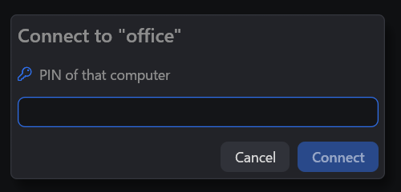

<p align="center">
  
</p>

<h1 align="center">Remote Desktop Rider</h1>

<p align="center">
  <b>Fast, private 1:1 remote desktop for Windows that stays usable on bad connections.</b><br>
  Help a family member, reach your office PC from home, or support a customer:<br>
  over mobile data, hotel Wi-Fi or a VPN with high latency and packet loss.
</p>

<p align="center">
  <a href="https://github.com/codewithelvin/remote-desktop-rider/releases/latest"></a>
  <a href="https://github.com/codewithelvin/remote-desktop-rider/actions/workflows/ci.yml"></a>
  
  
</p>

## Highlights

- **Smooth on poor networks.** QUIC over UDP, a cursor drawn locally, stale
  frames dropped instead of resent, and bitrate that adapts live (300 kbps–20 Mbps).
- **Private by design.** Devices pair once by comparing a code, every session is
  end-to-end encrypted and needs the computer's PIN. No accounts, no cloud.
- **Works everywhere.** Login screen, lock screen, UAC prompts and after a
  restart. Direct connection on the same network, NAT hole punching or an
  encrypted relay across the internet.
- **Self-hosted.** The optional `rider-server` runs on any small Linux server and
  only introduces devices: it can't see or take over sessions.
- **Small and native.** One ~8 MB installer, hardware H.264 encoding
  (QuickSync / NVENC / AMF), clipboard sync and file drop.

## Download

Get **rdr-setup-x.y.z.exe** from the
[latest release](https://github.com/codewithelvin/remote-desktop-rider/releases/latest)
and run it on both computers (Windows 10/11, 64-bit). Every change on `main` is
built and published there automatically.

> The installer is not code-signed yet, so Windows SmartScreen may warn about an
> unknown publisher: click **More info → Run anyway**.

**Updates install themselves.** The app checks the releases every few hours and
shows *Version x is available → Install update* (one Windows permission prompt;
it reopens by itself). A computer with remote access turned on also updates
unattended: its service installs a new release when nobody is connected and is
back online within a minute, so a PC you only reach remotely stays current.
Every download is checked against the SHA-256 published with the release. Both
can be turned off (Settings → Updates; Manage → Remote access), and IT can still
deploy silently with `rdr-setup-x.y.z.exe /VERYSILENT /SUPPRESSMSGBOXES /NORESTART`.

## How it works

<table>
  <tr>
    <td width="50%"></td>
    <td width="50%"></td>
  </tr>
  <tr>
    <td><b>1. On the computer to control</b>: open <i>This computer → Manage this
    computer</i>, set a PIN, turn on remote access and click <b>Add a device</b>.
    It shows a short code.</td>
    <td><b>2. On your device</b>: click <b>Add computer</b>, enter that code and
    check that both screens show the same verification code. Done once.</td>
  </tr>
</table>



**3. Connect** whenever you need: click **Connect** and enter the PIN. Tick
**Remember PIN on this device** and later connections open straight away, like
unattended access in other tools (the PIN is encrypted for your Windows
account). The remote computer shows a red banner while someone is connected;
clicking it ends the session.

The app lives in the notification area, starts when you sign in (can be turned
off in Settings) and shows which of your computers are online. To reach
computers on other networks, enter your `rider-server` address and fingerprint
once per computer in **This computer → Manage → Server**: it applies to both
directions (being reached and reaching others). Networks that filter UDP port
47800 (some company firewalls) are handled automatically: the host falls back
to a random high port for the server and for sessions through it.

<br clear="right">

### In a session

Click the small tab at the top centre of the session window for the toolbar:
**Full screen**, **Ctrl+Alt+Del**, one button per remote **monitor** and
**Disconnect**. Windows key combinations (Win+R, Win+E, Win+P…), Alt+Tab, Alt+Esc and
Alt+F4 act on the remote computer while its window is in front. Win+L and
Ctrl+Alt+Del always stay on your own computer (Windows reserves them), so use
the toolbar or `Ctrl+Alt+End` for the remote one.

| Shortcut | Action |
|---|---|
| `Ctrl+Alt+End` | Ctrl+Alt+Del on the remote computer (login / lock screen) |
| `Ctrl+Alt+Shift+M` | next monitor |
| `Ctrl+Alt+Shift+F` | toggle fullscreen |
| `Ctrl+Alt+Shift+Q` | disconnect |
| drag a file onto the window | send it to the remote user's `Downloads\Rider` |

Text clipboard syncs both ways. Picture quality adjusts itself to the
connection: there is nothing to set. The title bar shows fps, round-trip time,
estimated latency and the encoder in use.

## Under the hood

### Why it stays fast

| Problem on bad links | What Rider does |
|---|---|
| TCP head-of-line blocking (one lost packet freezes everything) | **QUIC over UDP**. Each video frame travels on its own stream, and mouse motion goes as unreliable datagrams. |
| Retransmitting stale pixels | Frames that are not delivered within 500 ms are **abandoned**. The client asks for a fresh keyframe instead of waiting. |
| Queues building up (bufferbloat) | **At most 3 frames in flight**. If the network is busy, capture is skipped, so the next frame is always *now*. |
| Random loss collapsing throughput | **BBR** congestion control plus a delay-based **adaptive bitrate** (300 kbps–20 Mbps, changed live without keyframes). |
| Encoder/decoder buffering | H.264 in **low-latency mode**: no B-frames, CBR, hardware encoder (QuickSync / NVENC / AMF) with software fallback. |
| Laggy pointer | The **cursor is drawn locally** on the client, so it never waits for the network. |
| Wasted bandwidth on static screens | **Zero traffic** when nothing changes, then a few refinement frames sharpen the image. |

### Security model

- Every device has its own **Ed25519 identity key**. There is no CA and no central
  server that could be compromised to impersonate a host.
- **One-time pairing:** the host opens a pairing window (`rider-host pair`). Both
  screens show a 6-digit **verification code** derived from both keys *and* the
  live TLS session. The two people compare the codes; a man-in-the-middle would
  produce different codes.
- After pairing, both sides **pin** each other's key. The host rejects unpaired
  devices **during the TLS handshake**, before any application code runs. The
  client refuses a host whose key changed.
- Every session also requires the host **PIN** (Argon2id-hashed, exponential
  back-off, locked for 15 minutes after 10 failures). A stolen client laptop is
  not enough on its own.
- While someone is connected, the host shows a **red banner**. The banner is
  hidden from the stream. Clicking it ends the session immediately.

## Command line

The app runs these tools for you; they also work on their own. All host
commands need an **elevated** terminal (Run as administrator): the host's private key and trust store live in `%ProgramData%\RemoteDesktopRider`,
readable only by SYSTEM and Administrators.

On the **host** (the machine to be controlled):

```powershell
rider-host set-pin             # once
rider-host service install     # unattended access: login screen, UAC, after reboot
rider-host pair                # once per new client device (pauses the service meanwhile)
```

`service install` copies the binary to `%ProgramFiles%\RemoteDesktopRider`, so
only administrators can replace what runs as SYSTEM. It also adds a firewall
rule for UDP 47800, registers auto-restart on failure, and allows Ctrl+Alt+Del
from services. `rider-host service status|stop|start|uninstall` manage it, and
`set-pin`, `revoke` and `clients` apply to the running service immediately.
`rider-host auto-update on|off` controls unattended updates (on by default).
Logs: `%ProgramData%\RemoteDesktopRider\host\logs`.

Without the service, `rider-host` (or `rider-host run --pair`) serves from the
terminal until Ctrl+C.

On the **client**:

```powershell
rider-client pair 192.168.1.20 --name office   # compare the code with the host
rider-client connect office                     # asks for the PIN
```

### Across the internet with the command line

Without a server, the client needs the host's address, so it only works on the
same network, over a VPN or through a port forward. To connect from anywhere,
run the small `rider-server` on any machine both sides can reach (a cheap VPS):

```sh
rider-server run                 # UDP 47900 + relay ports 47901-47999
rider-server info                # prints the fingerprint for the commands below
```

To install or upgrade it on a Linux server with systemd, copy the `rider-server`
binary next to `deploy/install.sh` and `deploy/rider-server.service` and run
`sudo bash install.sh <public-ip>`. It sets up the hardened unit, opens the UDP
ports in ufw and prints the fingerprint. Then, once per device:

```powershell
rider-host   set-server vps.example.com <server-fingerprint>   # host; restart the service after
rider-client set-server vps.example.com <server-fingerprint>
```

`rider-host pair` now also shows a short code (e.g. `SF6-CK6`); on the client,
`rider-client pair SF6-CK6` works from any network. `connect` asks the server
for the host's addresses, punches through both NATs and uses a direct path
when one works (LAN first), or the server's relay when it doesn't. The viewer
prints which path it chose. If the server is down, a known direct address is
still tried.

The server only introduces devices. Sessions stay end-to-end encrypted with
the keys pinned at pairing, so the server can't watch or take over a session,
and it can't impersonate a host (the verification code would differ when
pairing by code). It answers the same "offline or not allowed" to everyone who
isn't paired with a host and rate-limits requests per IP.


### How unattended access works

A service running in session 0 can't see the screen. The `RemoteDesktopRider`
service (LocalSystem) therefore launches `rider-host agent` **as SYSTEM inside
the active console session** and relaunches it whenever that session changes
(logon, logoff, user switch) or the agent exits. The agent runs in a
kill-on-close job object, so it never outlives the service. Its capture and
input threads follow the *input desktop*, which is how they reach the login
screen, lock screen and UAC prompts. Ctrl+Alt+Del is generated with `SendSAS`.

### Layout

```
crates/
  rider-core    identity, pinned TLS, pairing code, protocol, clipboard, pixel conversion
  rider-media   Media Foundation H.264 encoder (hardware first) and decoder
  rider-host    capture (DXGI, GDI fallback), video pipeline, input injection, banner,
                sessions, Windows service + SYSTEM session agent
  rider-client  CLI, network session, in-order decoder thread, viewer window
  rider-server  rendezvous (registration, pairing codes, NAT hole punching) and UDP relay
  rider-app     the desktop app (computer list, pairing, this computer's settings, tray)
packaging/      Windows installer (Inno Setup)
deploy/         systemd unit and install script for rider-server
test/           Vagrant VMs: Windows 11 host (vm/), Ubuntu rider-server (server-vm/)
```

## Building

Needs Rust stable, the MSVC build tools and the Windows 10/11 SDK (`rc.exe`, for
the app icon).

```powershell
cargo build --release              # optimised, as released
cargo build --profile quick        # day-to-day: no LTO, ~30 s rebuilds (target\quick)
.\packaging\windows\build.ps1      # installer (needs Inno Setup 6) -> target\installer
```

Releases are made by GitHub Actions: every push to `main` passes fmt, clippy and
the tests, gets the next patch version (`v0.1.0`, `v0.1.1`, …) and is published
with its installer. Bump `major.minor` in `Cargo.toml` for bigger steps.

## Roadmap

See [docs/ROADMAP.md](docs/ROADMAP.md). Next up: all monitors in one window,
code signing, then performance on poor links (GPU
conversion and decoding, FEC, intra-refresh) and host→client files, audio and
an audit log.
